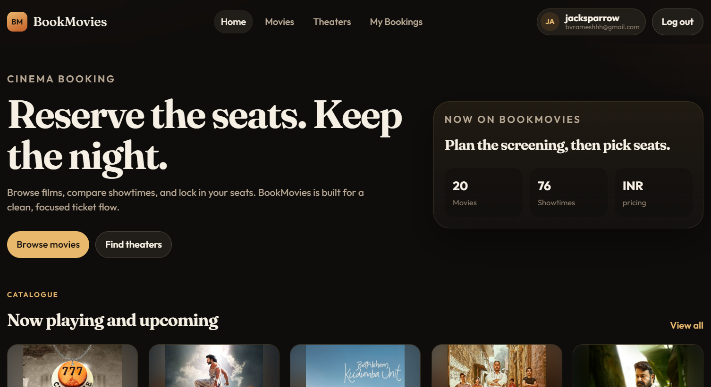
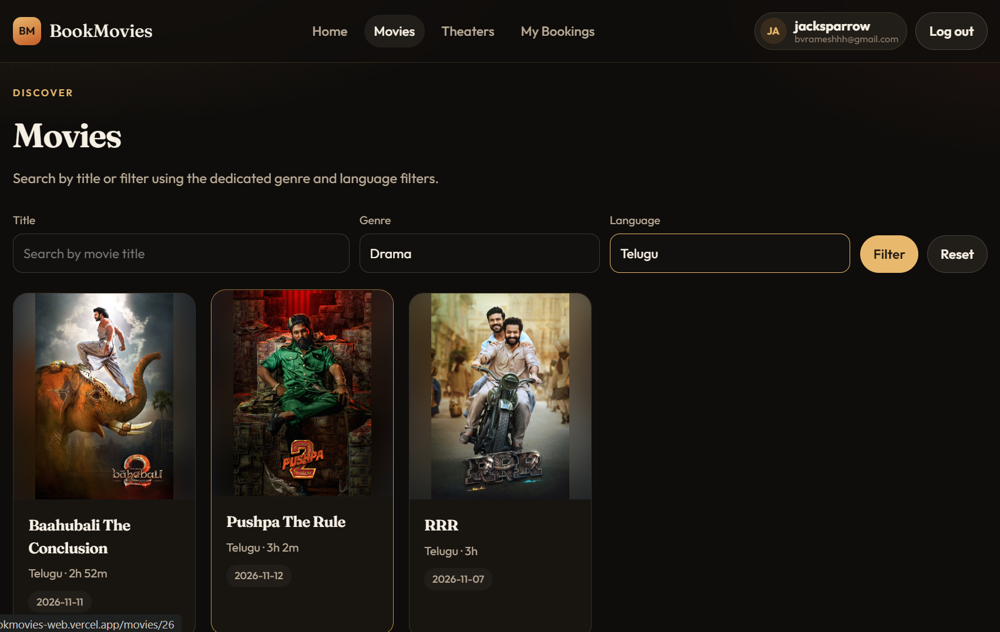
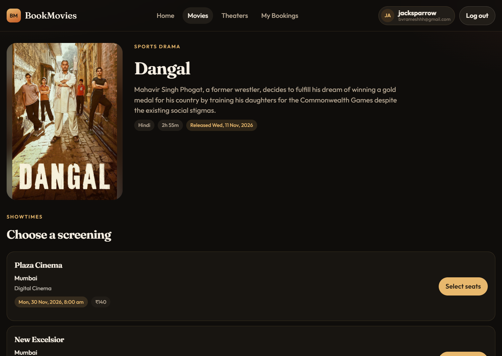
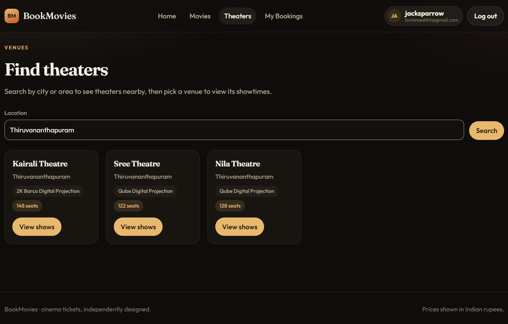
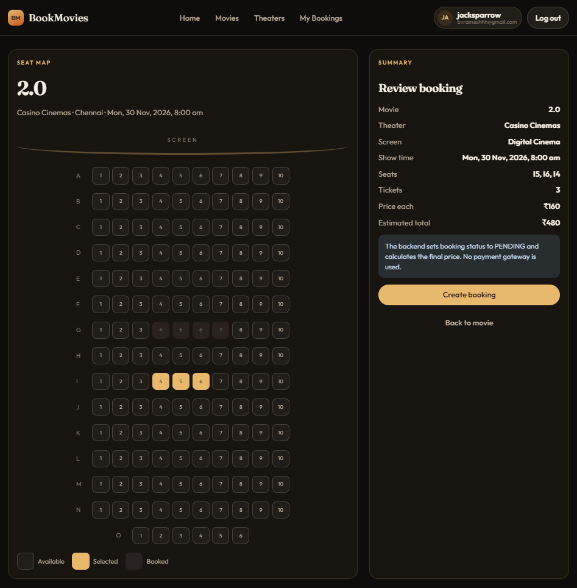
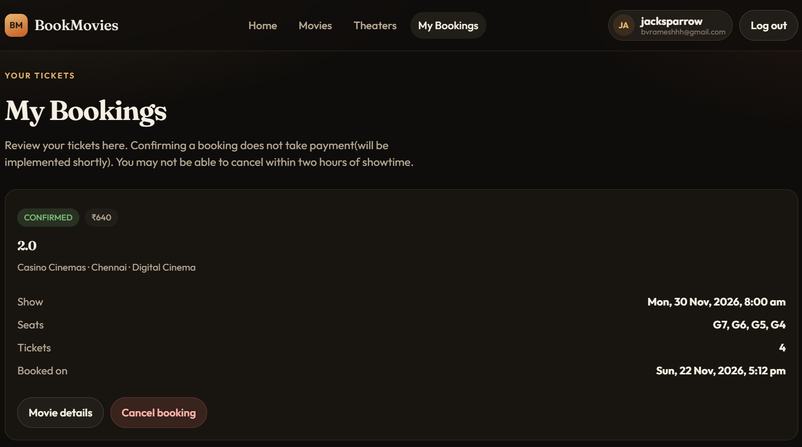
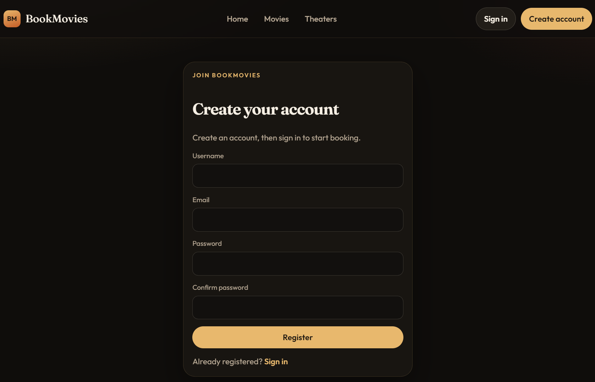
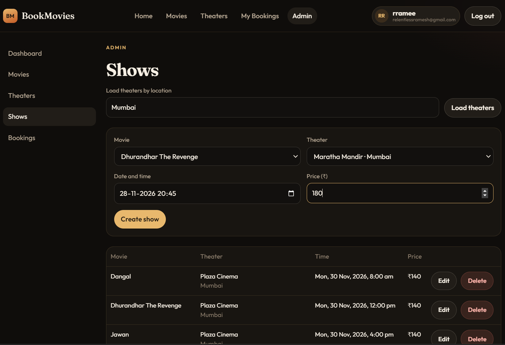
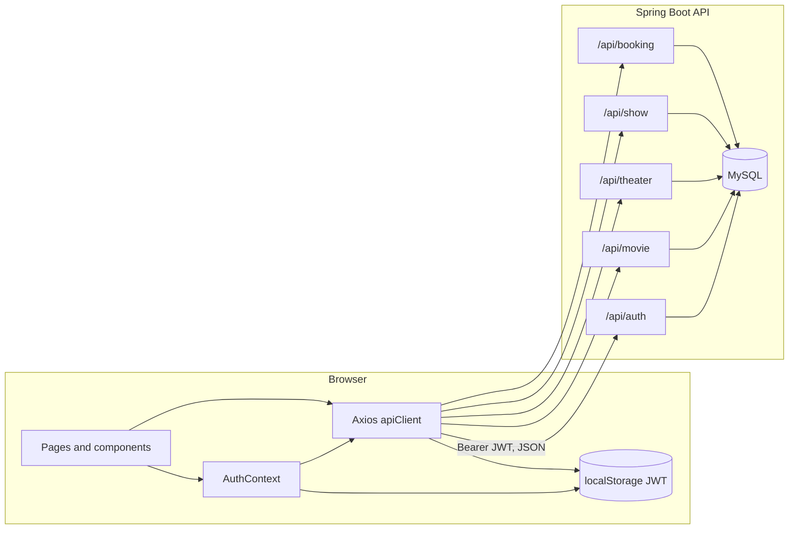

# BookMovies Frontend

A React client for **BookMovies**, a movie ticket booking application. Users can register, sign in, browse movies and theaters, pick showtimes, select seats, and manage bookings. Administrators can maintain catalogue data and review bookings.

This repository is the **frontend only**. The API(backend) is a separately developed Java / Spring Boot service with Spring Security, JWT authentication, and MySQL.

**Live Application:** [https://bookmovies-web.vercel.app](https://bookmovies-web.vercel.app)  
**Backend Repository:** [BookMovies-Backend](https://github.com/bagadivenkatramesh/BookMovies)

---

## Table of contents

1. [Project title and description](#1-project-title-and-description)
2. [Screenshots / application preview](#2-screenshots--application-preview)
3. [Key features](#3-key-features)
4. [Technology stack](#4-technology-stack)
5. [AI-assisted development](#5-ai-assisted-development)
6. [Application architecture](#6-application-architecture)
7. [Project folder structure](#7-project-folder-structure)
8. [Authentication and authorization](#8-authentication-and-authorization)
9. [Backend API integration](#9-backend-api-integration)
10. [Environment configuration](#10-environment-configuration)
11. [Local installation and setup](#11-local-installation-and-setup)
12. [Running the application](#12-running-the-application)
13. [Production build](#13-production-build)
14. [Deployment information](#14-deployment-information)
15. [Future improvements](#15-future-improvements)

---

## 1. Project title and description

**BookMovies** is a full-stack cinema booking product split across two repositories.

The frontend (this project) provides the customer booking flow and an admin area. It is a single-page application built with React 19, Vite, React Router, and Axios. Styling is a global CSS design system in `src/index.css` (no CSS-in-JS or utility framework).

The backend (separate repository) owns users, movies, theaters, shows, bookings, and JWT-secured REST endpoints. The frontend does not persist booking data itself; it calls the API and renders loading, empty, and error states from those responses.

Typical customer flow:

1. Create an account and sign in.
2. Browse or filter movies, or search theaters by location.
3. Open a movie or theater, choose a showtime, and select seats.
4. Create a booking (backend status starts as `PENDING`).
5. Confirm or cancel from **My Bookings**.

There is no payment gateway as of now. It will be implemented very shortly. For now, confirmation is an API status change, not a paid checkout.

---

## 2. Screenshots / application preview

### 1. Home Page
Explore the application and featured movies.



### 2. Movies
Browse available movies.



### 3. Movie Details
View movie information and available shows.



### 4. Theaters
Explore theaters and their shows.



### 5. Seat Selection
Select seats for a show.



### 6. My Bookings
View booking history and status.



### 7. User Authentication
Sign up or log in.



### 8. Admin Dashboard
Manage movies, theaters, and shows.




---

## 3. Key features

Catalogue pages (home, movies, movie details, theaters, seats) are reachable without a route guard, but they **do not load API data until the user is signed in**. They use an `AuthRequired` gate with a sign-in prompt. **My Bookings** and all `/admin` routes are route-protected.

### Regular user

| Feature | Implementation |
|---|---|
| Registration | Username, email, password (min. 6 characters), confirm password. Calls `POST /api/auth/register_normal_user`. Redirects to login. |
| Login | Username and password. Stores JWT and loads `/api/auth/me`. |
| Logout | Clears the stored token and in-memory user. |
| Home | Authenticated catalogue preview (up to eight movies) and showtime count. |
| Movie browsing | List all movies, or search by title, genre, or language, with extra client-side filtering. |
| Movie details | Movie by ID, then showtimes for that title. |
| Theater search | Search by location string; open a venue to list its shows. There is no “list all theaters” API. |
| Seat selection | Client-generated grid from theater seat capacity; occupied seats come from non-cancelled bookings for that show. |
| Create booking | Selected seats posted to `POST /api/booking/create_booking`. Backend creates a `PENDING` booking and prices it. |
| My Bookings | List current user’s bookings; confirm (`PENDING` → confirmed) or cancel. Copy notes that cancel near showtime may be rejected by the backend. |

### Administrator (`ROLE_ADMIN`)

Admin UI is shown only when the current user’s roles include `ROLE_ADMIN`. The backend still enforces the same restrictions on write and admin-only endpoints.

| Feature | Implementation |
|---|---|
| Dashboard | Movie count, show count, pending bookings, confirmed bookings (status queries). Theater totals are omitted because there is no get-all-theaters endpoint. |
| Movies | Create, update, delete; list all movies. Fields: name, description, genre, language, release date, duration, poster URL. |
| Theaters | Create, update, delete. Existing venues are loaded by **location search**, not a full list. |
| Shows | Create, update, delete. Movie dropdown from all movies; theaters from shows plus optional location lookup. Delete is refused by the backend if the show already has bookings. |
| Bookings | Filter by `PENDING`, `CONFIRMED`, or `CANCELLED`, or look up a show ID. Confirm and cancel actions. No list-all-bookings endpoint. |

### Features that are going to be implemented very shortly

- Payment processing
- Concurrency-safe seat booking
- Password reset / email verification
- Admin account creation from this UI (only normal-user registration)
- Automated tests

---

## 4. Technology stack


| Layer | Technology | Version |
|---|---|---|
| UI library | React, React DOM | `^19.2.8` (lockfile: 19.3.0) |
| Language | JavaScript (JSX) | — |
| Bundler / dev server | Vite | `^8.3.0` (lockfile: 8.3.0) |
| Routing | react-router-dom | `^7.18.3` |
| HTTP | Axios | `^1.20.0` |
| Styling | Global CSS (`src/index.css`), CSS custom properties | — |
| Fonts | Outfit, Fraunces (Google Fonts) | — |
| Linting | ESLint 10 with React Hooks and React Refresh plugins | see `package.json` |
| Hosting (frontend) | Vercel (SPA rewrites in `vercel.json`) | — |

**Backend (separate repo):** Java, Spring Boot, Spring Security, JWT, MySQL.

**Development tools (not runtime dependencies):** Cursor AI (see [AI-assisted development](#5-ai-assisted-development)), npm, Git.

**State management:** React Context for session (`AuthContext`) and local `useState` / `useEffect` on pages. There is no Redux, Zustand, or React Query.

---

## 5. AI-assisted development

This frontend was built with **extensive Cursor AI assistance**. Generated and refined work included React components, page layouts, styling, routing, Axios client wiring, and form/error UX. The result is a working client that talks to a real backend; it is not presented as a fully hand-written UI from scratch.

I independently **designed and implemented the Spring Boot backend** (security, JWT, MySQL, booking APIs). On the frontend I directed the product flow, reviewed and iterated on AI-generated code, and connected it to those APIs. I do not claim that every component was independently authored or that every generated line was written by hand.

Using AI here is intentional: it is part of how I ship UI quickly while keeping backend ownership, API contracts, and review on me.

---

## 6. Application architecture

```text
src/
  App.jsx          BrowserRouter + AuthProvider
  routes/          Route table, ProtectedRoute, AdminRoute
  layouts/         Shell (navbar/footer) and admin sidebar
  pages/           Route-level screens
  components/      Movies, seats, bookings, shared UI
  api/             Axios instance + per-resource functions
  context/         Auth session
  utils/           Token storage, errors, seats, formatters
```

Pages own their data fetching. Shared UI (`PageState`, `AuthRequired`, `Alert`, `Spinner`, `EmptyState`) standardizes loading, errors, and empty results. API modules wrap REST paths; they do not contain React.



Seat labels are generated in the browser from `theaterSeatCapacity` (10 seats per row). Occupied seats are derived from bookings that are not `CANCELLED`. A future backend seat-layout model could replace `src/utils/seatLayout.js` without changing the rest of the booking flow.

---

## 7. Project folder structure

```text
bookmovies-frontend/
├── index.html
├── package.json
├── vite.config.js
├── vercel.json
├── eslint.config.js
├── public/                 # favicon, static poster assets
└── src/
    ├── main.jsx
    ├── App.jsx
    ├── index.css
    ├── api/
    │   ├── apiClient.js
    │   ├── authApi.js
    │   ├── movieApi.js
    │   ├── theaterApi.js
    │   ├── showApi.js
    │   └── bookingApi.js
    ├── context/
    │   └── AuthContext.jsx
    ├── routes/
    │   ├── AppRoutes.jsx
    │   ├── ProtectedRoute.jsx
    │   └── AdminRoute.jsx
    ├── layouts/
    │   ├── MainLayout.jsx
    │   └── AdminLayout.jsx
    ├── pages/
    │   ├── HomePage.jsx
    │   ├── MoviesPage.jsx
    │   ├── MovieDetailsPage.jsx
    │   ├── TheatersPage.jsx
    │   ├── SeatSelectionPage.jsx
    │   ├── MyBookingsPage.jsx
    │   ├── LoginPage.jsx
    │   ├── RegisterPage.jsx
    │   ├── ForbiddenPage.jsx
    │   ├── NotFoundPage.jsx
    │   └── admin/
    ├── components/
    │   ├── common/
    │   ├── layout/
    │   ├── movies/
    │   ├── shows/
    │   ├── seats/
    │   └── bookings/
    └── utils/
```

| Path | Role |
|---|---|
| `src/api` | HTTP client and endpoint wrappers |
| `src/context` | JWT session and `useAuth()` |
| `src/routes` | Public, authenticated, and admin routing |
| `src/pages` | Screens; `pages/admin` is the back office |
| `src/components` | Reusable presentational pieces |
| `src/utils` | Token key, error messages, dates/prices, seat grid |

`node_modules` and `dist` are build artifacts and are not part of the source layout.

---

## 8. Authentication and authorization

### Login and session restore

1. `POST /api/auth/login` returns `{ jwtToken }`.
2. The token is stored in `localStorage` under `bookmovies_access_token` (`src/utils/tokenStorage.js`).
3. `GET /api/auth/me` loads `{ id, username, email, roles }`.
4. On startup, if a token exists, the app calls `/api/auth/me` again. A 401 clears the session. Other failures keep the token but leave `currentUser` unset until a later refresh.

`isAuthenticated` is true only when **both** a token and a current user are present. `isAdmin` is true when `roles` includes `ROLE_ADMIN`.

Logout is client-side: the token and user are cleared; there is no logout API call.

### Attaching the token

The Axios request interceptor adds `Authorization: Bearer <token>` to requests except login and `register_normal_user`.

### Failures

- **401** on non-credential requests: token is removed and `AuthContext` clears the user.
- Login/register 401/400: the form shows `error.displayMessage` (from the response body or a status fallback in `src/utils/errors.js`).
- Network errors: a message asking the user to confirm the backend is reachable (default local port 8080).

### Route protection

| Guard | Used on | Behavior |
|---|---|---|
| `ProtectedRoute` | `/my-bookings` | Spinner while session restores; otherwise redirect to `/login` with `state.from`. |
| `AdminRoute` | `/admin/*` | Same as protected, then `ForbiddenPage` if the user is not `ROLE_ADMIN`. |
| `AuthRequired` | Home, movies, details, theaters, seats | In-page sign-in empty state instead of a redirect. |

Frontend checks only hide UI. Admin mutations still depend on Spring Security on the server.

---

## 9. Backend API integration

Base URL: `import.meta.env.VITE_API_BASE_URL`, falling back to `http://localhost:8080`. Axios timeout is 20 seconds. JSON request bodies. List helpers coerce non-array payloads with `asArray()`.

Responses attach `error.displayMessage` in the interceptor so pages can show a single string. Many screens use `PageState` for spinner, retryable error banner, and empty copy.

### Endpoints used

**Auth**

| Method | Path |
|---|---|
| POST | `/api/auth/login` |
| POST | `/api/auth/register_normal_user` |
| GET | `/api/auth/me` |

**Movies**

| Method | Path |
|---|---|
| GET | `/api/movie/get_all_movies` |
| GET | `/api/movie/get_movies_by_genre` |
| GET | `/api/movie/get_movies_by_language` |
| GET | `/api/movie/get_movie_by_title` |
| GET | `/api/movie/get_movie_by_id/{movieId}` |
| POST | `/api/movie/add_movie` |
| PUT | `/api/movie/update_movie/{id}` |
| DELETE | `/api/movie/delete_movie/{id}` |

**Theaters**

| Method | Path |
|---|---|
| GET | `/api/theater/get_theaters_by_location` |
| POST | `/api/theater/add_theater` |
| PUT | `/api/theater/update_theater/{id}` |
| DELETE | `/api/theater/delete_theater/{id}` |

**Shows**

| Method | Path |
|---|---|
| GET | `/api/show/get_all_shows` |
| GET | `/api/show/get_shows_by_movie/{movieId}` |
| GET | `/api/show/get_shows_by_theater/{theaterId}` |
| POST | `/api/show/create_show` |
| PUT | `/api/show/update_show/{id}` |
| DELETE | `/api/show/delete_show/{id}` |

Seat selection resolves a show by ID by loading **all shows** and finding a match. There is no dedicated show-by-id client call.

**Bookings**

| Method | Path |
|---|---|
| POST | `/api/booking/create_booking` |
| GET | `/api/booking/my_bookings` |
| GET | `/api/booking/get_bookings_for_show/{showId}` |
| GET | `/api/booking/get_bookings_by_status/{bookingStatus}` |
| PUT | `/api/booking/confirm_booking/{bookingId}` |
| PUT | `/api/booking/cancel_booking/{bookingId}` |

Production API host used with the Vercel frontend: `https://bookmovies-production.up.railway.app` (configure as `VITE_API_BASE_URL` on the host; do not commit secrets).

---

## 10. Environment configuration

Vite exposes only variables prefixed with `VITE_`. There is no committed `.env` or `.env.example`. `.env` and `.env.*` are gitignored.

| Variable | Required | Purpose | Example |
|---|---|---|---|
| `VITE_API_BASE_URL` | Recommended | Spring Boot origin (no trailing path) | `http://localhost:8080` |

If unset, the client uses `http://localhost:8080`.

**Local `.env`**

```dotenv
VITE_API_BASE_URL=http://localhost:8080
```

**Production (hosting dashboard, not the repo)**

```dotenv
VITE_API_BASE_URL=https://bookmovies-production.up.railway.app
```

Do not put JWT secrets, database passwords, or Spring signing keys in this frontend. The browser only stores the **user access token** after login.

Restart `npm run dev` after changing `.env`.

---

## 11. Local installation and setup

### Prerequisites

- **Node.js** `^20.19.0` or `>=22.12.0` (required by Vite 8)
- **npm** (comes with Node)
- **Git**
- A running [BookMovies backend](https://github.com/bagadivenkatramesh/BookMovies) (default `http://localhost:8080`), with CORS allowing the Vite origin

### Install

```bash
git clone https://github.com/bagadivenkatramesh/BookMovies-Frontend.git
cd BookMovies-Frontend
npm install
```

Create `.env` in the project root as shown in [Environment configuration](#10-environment-configuration).

---

## 12. Running the application

```bash
npm run dev
```

Vite serves the app at **http://localhost:5173** (port may change if 5173 is taken).

```bash
npm run lint
```

Runs ESLint on the project (`eslint .`).

Use a normal-user account for booking, and an admin account created on the backend for `/admin`.

---

## 13. Production build

```bash
npm run build
```

Output: `dist/`. Preview locally:

```bash
npm run preview
```

Set `VITE_API_BASE_URL` to the deployed API **before** `npm run build`; Vite inlines it at build time.

---

## 14. Deployment information

| Component | Platform | URL |
|---|---|---|
| This React app | Vercel | [https://bookmovies-web.vercel.app](https://bookmovies-web.vercel.app) |
| Spring Boot API | Railway | `https://bookmovies-production.up.railway.app` |
| MySQL | Railway | not exposed to the browser |

`vercel.json` rewrites all paths to `index.html` so client routes such as `/movies/1` and `/admin/shows` work on refresh.

On Vercel, define `VITE_API_BASE_URL` for the production environment and redeploy after changing it.

---

## 15. Future improvements

These are **not** current features.

| Area | Why it matters |
|---|---|
| Payment provider | Confirmation is a status update only. |
| Concurrecy-safe seat booking | Guarantees no double-booking of seats under concurrent requests. |
| HttpOnly cookie or a tighter token store | JWT in `localStorage` is convenient and XSS-sensitive. |
| Show-by-id and list-all-theaters APIs | Seat page currently scans all shows; theater admin requires a location search. |
| Backend-defined seat maps | Labels are generated from capacity, not a stored layout. |
| Public catalogue without login | Movie and theater APIs are treated as authenticated in this UI. |
| Automated tests | No unit or end-to-end suite in this repo. |
| `.env.example` | Would document `VITE_API_BASE_URL` without copying production values. |
| Remove leftover debug logging | `SeatSelectionPage` still logs bookings to the console. |

---

## License

Private project (`"private": true` in `package.json`). All rights reserved unless a license file is added.
